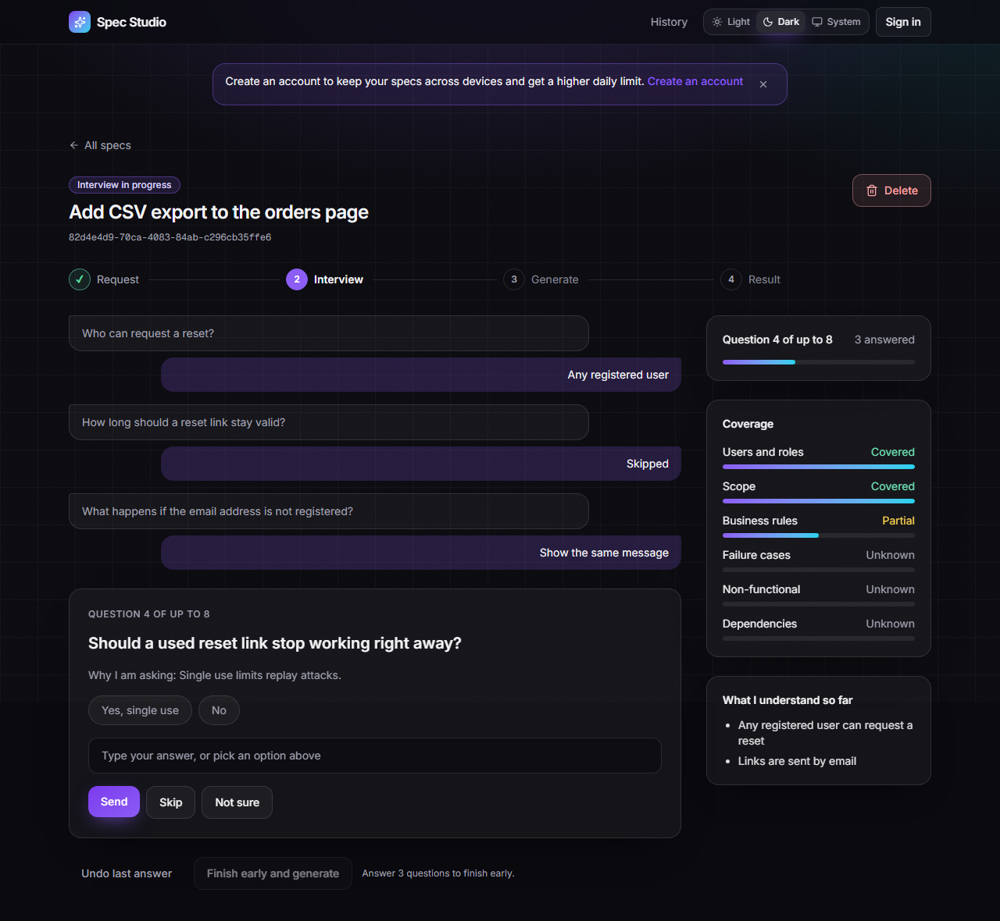
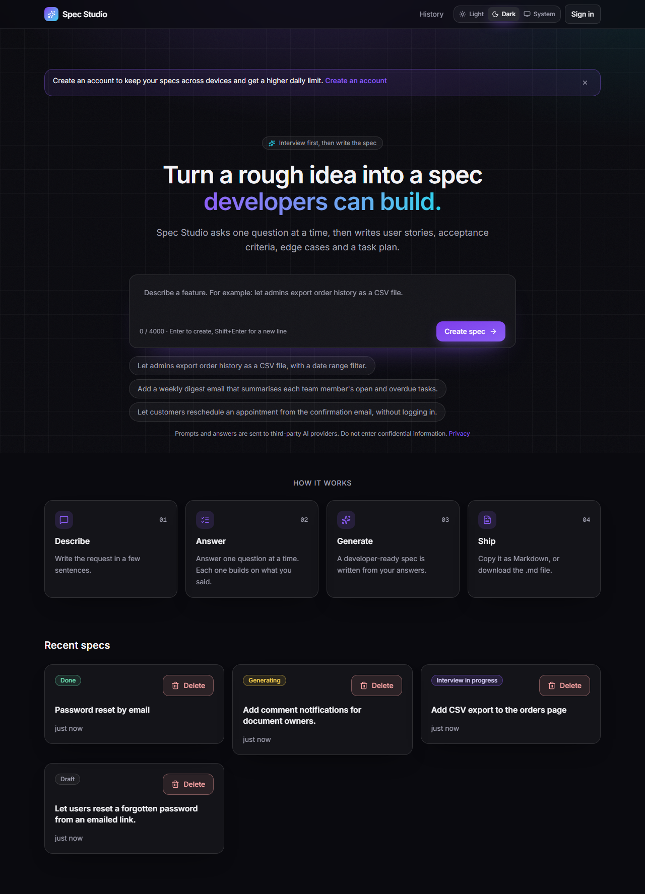
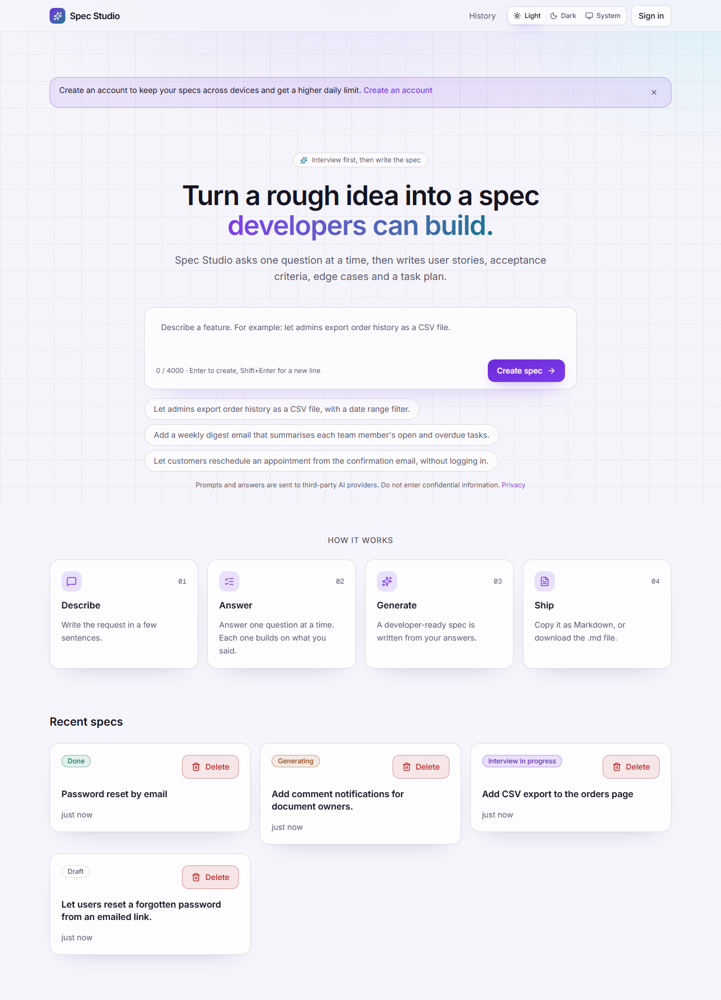
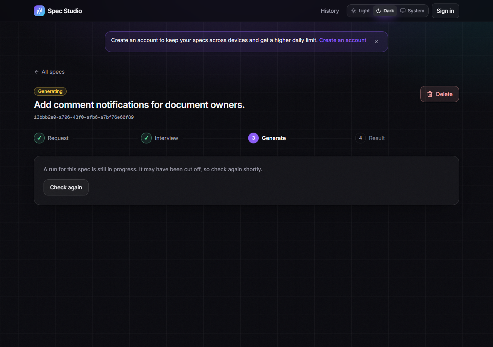
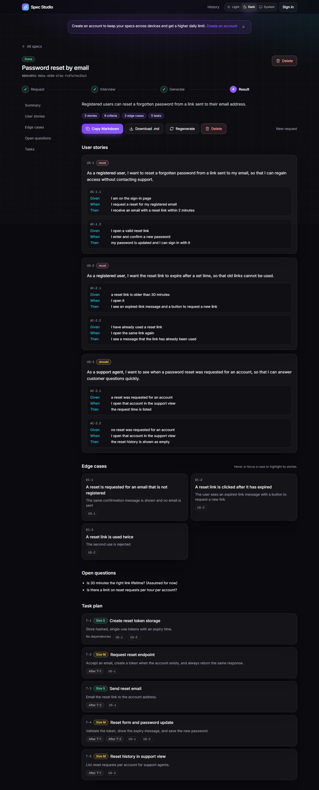
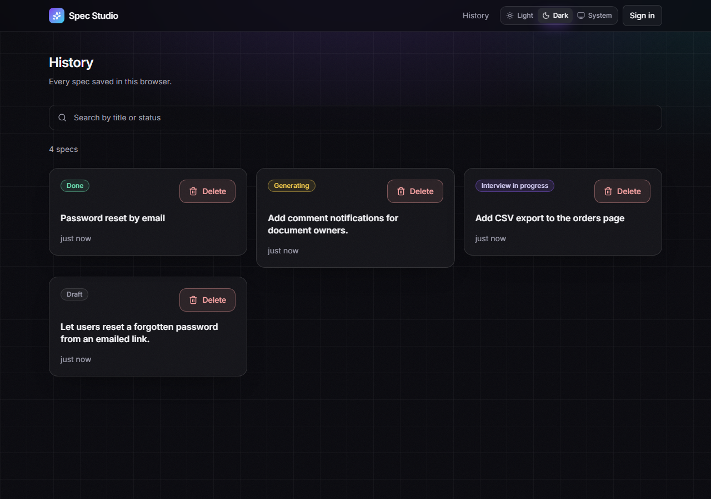
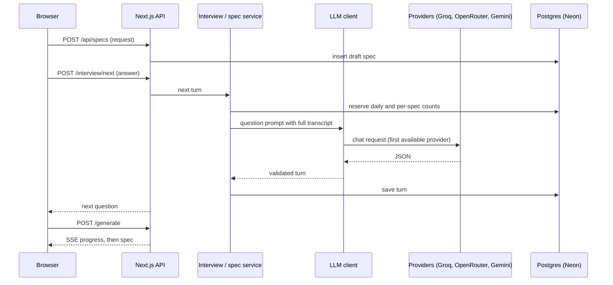

# Spec Studio

Turns a rough feature request into a developer-ready spec by asking one question at a time.

[](https://github.com/anudeepbakka/spec-studio/actions/workflows/ci.yml)
[](LICENSE)

**Live demo:** [spec-studio-nine.vercel.app](https://spec-studio-nine.vercel.app/)



## The problem

Vague feature requests cause rework. A developer finds the missing rules halfway through a build: who can do this, what happens when it fails, what counts as done. Those questions are cheaper to ask before anyone writes code.

## What it does

1. **Describe.** Paste a request of 20 to 4000 characters.
2. **Answer.** The app asks one question at a time. Each question is chosen from the request and every earlier answer. You can answer, skip, say "not sure", or finish early.
3. **Generate.** The spec is written from the full interview. Progress streams in while it is written.
4. **Result.** You get user stories with Given/When/Then criteria, edge cases, open questions, and a task plan. Copy it or download it as Markdown.











## Why I built it

The idea comes from business analysis: ask the right questions, in the right order, before building anything. I wanted to see whether free-tier language models could do that reliably, and whether their output could be checked rather than trusted. The project also tests spec-driven development: [SPEC.md](SPEC.md) drove the build, one task at a time, with Claude Code.

## Key features

- **One question per turn**, chosen from the request and every answer so far. See [`src/lib/interview/`](src/lib/interview/).
- **Coverage panel** across six dimensions, so you can see what is still unknown.
- **Undo, finish early, and resume.** Finish early needs three real answers. A reload returns you to the pending question.
- **Validated output.** Every model response is parsed and checked with Zod, then checked again for cross-references, duplicate IDs and dependency cycles. See [`src/lib/schemas/`](src/lib/schemas/).
- **Provider fallback** across Groq, OpenRouter and Gemini. A provider that returns 429 is skipped for 60 seconds.
- **Accounts and limits.** Guests use the app without signing up. An account (username and password, no email) keeps specs across browsers. New specs are capped per day (5 for guests, 8 for accounts), each spec gets 12 AI calls, and a global daily budget covers all users. All are checked before any provider is called. See [ARCHITECTURE](docs/ARCHITECTURE.md#identity-accounts-and-limits).

## How it works



Details are in [docs/ARCHITECTURE.md](docs/ARCHITECTURE.md).

## Engineering highlights

- **Provider fallback with cooldown.** One interface over three OpenAI-compatible APIs, tried in order. See [ARCHITECTURE](docs/ARCHITECTURE.md#error-and-fallback-flow).
- **Validation with one repair call.** Invalid output gets one repair attempt that quotes the exact errors back to the model, then moves to the next provider. See [PROMPT_DESIGN](docs/PROMPT_DESIGN.md#the-repair-prompt).
- **Streaming generation.** The generate endpoint streams progress with Server-Sent Events. Validation and the repair step run before the spec event is sent.
- **Limits reserved before the call.** The daily and per-spec counters are updated in one atomic statement before the provider is contacted, so parallel requests cannot overshoot.
- **An eval suite with metrics.** Scripted interviews run against the real providers, with validity, follow-up and call-cap metrics. See [EVALS](docs/EVALS.md).

## Eval results

Latest saved run: 2 of 8 cases, prompt v2, 30 October 2026. One case finished and one hit the per-spec call cap. These are small numbers and should be read as a snapshot, not a benchmark.

| Metric | Result |
|---|---|
| Interview questions valid on first attempt | 86% (12 of 14 steps) |
| Adaptive follow-ups (share of checked turns) | 50% (5 of 10) |
| Spec valid on first attempt | 50% (1 of 2 cases) |
| Spec produced after repair | 50% (1 of 2 cases) |
| Average LLM calls per case | 10 (cap 12, all within cap) |
| Average latency per case | 73 s (failed case included) |

Full table, method and limits: [docs/EVALS.md](docs/EVALS.md).

## Tech stack

| Layer | Choice | Why |
|---|---|---|
| Framework | Next.js 16 (App Router), TypeScript strict | Pages and route handlers in one project, deployed to Vercel |
| UI | Tailwind CSS with design tokens, framer-motion, lucide-react | Small hand-written components. Motion respects reduced-motion settings |
| Validation | Zod | One source of truth for types, shape rules and cross-reference checks |
| Database | Postgres on Neon, Drizzle ORM | Serverless Postgres on a free tier. Drizzle keeps the SQL visible |
| Accounts | Better Auth (username plugin, Drizzle adapter) | Passwords and sessions without hand-written crypto. Only four routes are exposed, and there is no email |
| LLM | OpenAI-compatible `fetch` (no vendor SDK) | Three free-tier providers behind one small interface |
| Streaming | Server-Sent Events from a route handler | One-way progress updates with no extra infrastructure |
| Tests | Vitest, PGlite (in-process Postgres) | Real SQL runs in tests without a database server |
| CI and hosting | GitHub Actions, Vercel | Lint, typecheck and tests on every push |

## Getting started

Prerequisites: Node.js 22 and a Postgres database (a free Neon project works).

```bash
git clone https://github.com/anudeepbakka/spec-studio.git
cd spec-studio
npm install
cp .env.example .env.local
```

Edit `.env.local`:

- `DATABASE_URL`: your Postgres connection string.
- For each provider you use, its API key and a model name. Free model names change often, so take them from the provider's current docs. A provider with no key is skipped. A key with no model stops startup with a clear message.
- `BETTER_AUTH_SECRET`: a long random string. Generate one with `openssl rand -base64 32`, or any other 32-byte random value encoded in base64.
- `BETTER_AUTH_URL`: the site's base URL. For local development, `http://localhost:3000`.
- `DAILY_SPEC_LIMIT`, `DAILY_SPEC_LIMIT_USER` and `GLOBAL_DAILY_LLM_CALL_BUDGET` are optional. They default to 5, 8 and 600.

Then:

```bash
npm run db:migrate
npm run dev
```

Open http://localhost:3000.

Checks:

```bash
npm run typecheck
npm run lint
npm run test
npm run build
```

Evals call the real providers and use your quota, so run them only when you want to:

```bash
npm run eval
```

End-to-end tests drive the account flows in a real browser. They build the app, start it on port 3100, and use the database in `.env.local`, so each run creates and then deletes one test account. Sign-up is limited to 5 per IP per hour, so run them sparingly. Install the browser once first:

```bash
npx playwright install chromium
npm run test:e2e
```

## Project structure

```text
src/app/              pages and route handlers (/, /specs/[id], /history, /sign-in, /sign-up, /privacy, /api/*)
src/components/       page components (wizard steps, result, history, account menu, guest banner)
src/components/ui/    design primitives (button, card, badge, chip, progress, toast)
src/lib/llm/          provider interface, registry, fallback, JSON repair
src/lib/prompts/      versioned prompts (v2)
src/lib/interview/    interview state machine (next, undo, finish, resume)
src/lib/specs/        spec generation service, wizard steps, per-spec and budget limits
src/lib/schemas/      Zod schemas and integrity checks
src/lib/db/           Drizzle schema and owner-scoped repository
src/lib/owner/        owner type (guest or user) and spec and usage scopes
src/lib/auth/         Better Auth config, the auth route gate, rate limits, claiming, account deletion
src/lib/theme/        theme choice and the script that applies it before first paint
src/lib/export/       Markdown export
e2e/                  Playwright tests for the account flows
evals/                cases, runner and saved results
scripts/              screenshot script (Playwright, demo data)
docs/                 documentation (this folder)
```

## Limitations and next steps

- **Evals are small.** The saved run covers 2 of 8 cases. One case hit the 12-call cap before it produced a spec. More runs are needed before any rate is treated as reliable.
- **The call cap is tight for free models.** Repairs and fallbacks use the same budget as questions, so a spec with a few retries can run out. The options are a separate repair budget or a higher cap.
- **Long generations may exceed a serverless time limit.** The Hobby tier of Vercel limits a function to 60 seconds, and one eval case took 128 seconds. The deployed timeout for long generations has not been measured.
- **Keyword metrics are proxies.** Follow-up and assumption checks use word overlap, not a judgement of quality. They are documented as such in the results.
- **Accounts have no email, verification or password reset, by design.** A forgotten password means losing the account and its specs. Sign-up and sign-in limits are stored in Postgres and are best effort, not a security boundary. There is no CAPTCHA.
- **Guests are identified by a cookie.** Clearing the cookie hides a guest's specs, and they cannot be recovered from another browser. Sign in to keep specs across browsers.
- **The live demo runs the code in this repository.** It was redeployed after the accounts and theme work, with the environment variables set.
- **No spec editing.** Regenerate or copy only, as the spec defines.

Design choices and the problems behind them are in [docs/DESIGN_DECISIONS.md](docs/DESIGN_DECISIONS.md).

## Documentation

- [Architecture](docs/ARCHITECTURE.md): system context, request flows, data model, fallback flow
- [Design decisions](docs/DESIGN_DECISIONS.md): the reasons behind the choices, and problems I hit
- [Prompt design](docs/PROMPT_DESIGN.md): the prompts, their rules, and failure modes
- [Evals](docs/EVALS.md): method, cases, results and how to rerun
- [Build process](docs/BUILD_PROCESS.md): how the project was built with spec-driven development
- [SPEC.md](SPEC.md): the specification the app was built from

## License and author

MIT. See [LICENSE](LICENSE).

Built by Bakka Anudeep.
