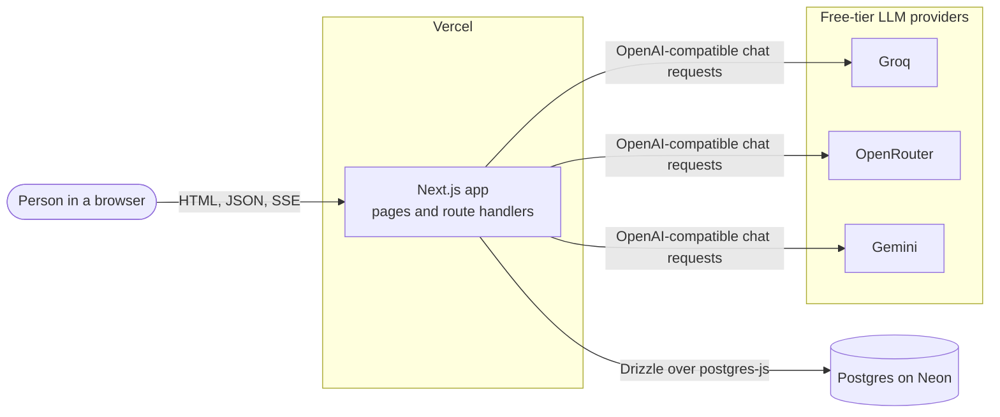
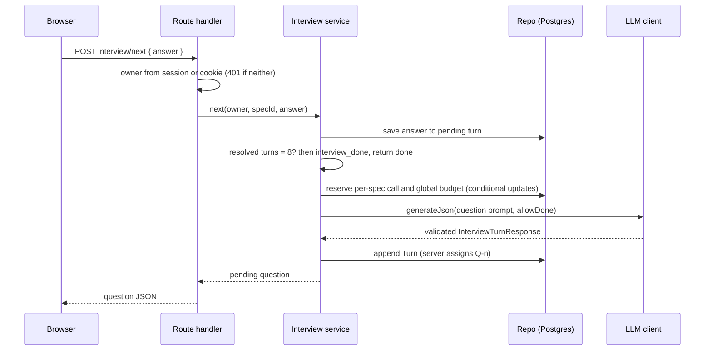
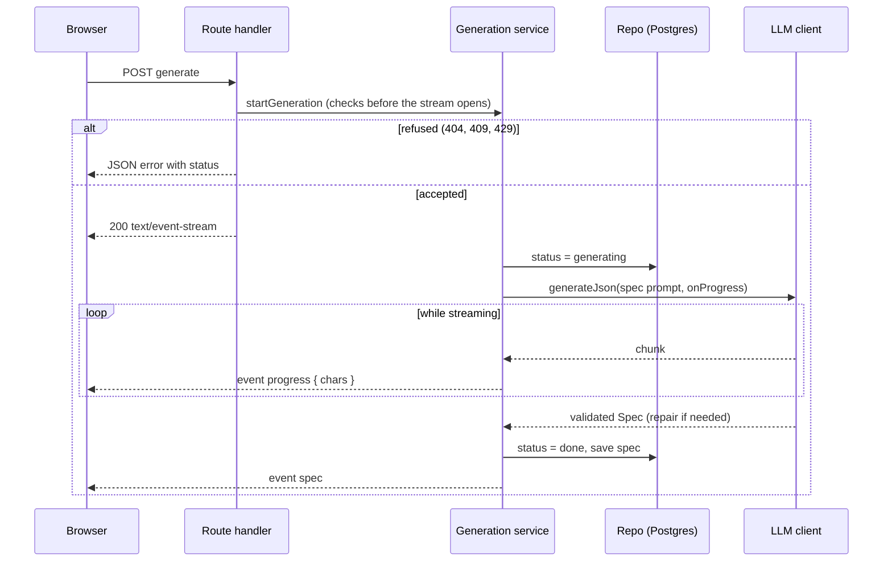
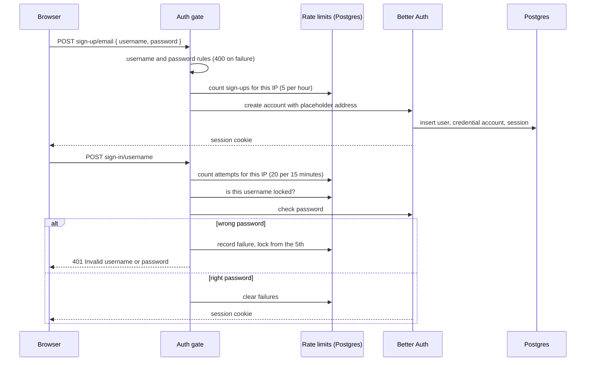
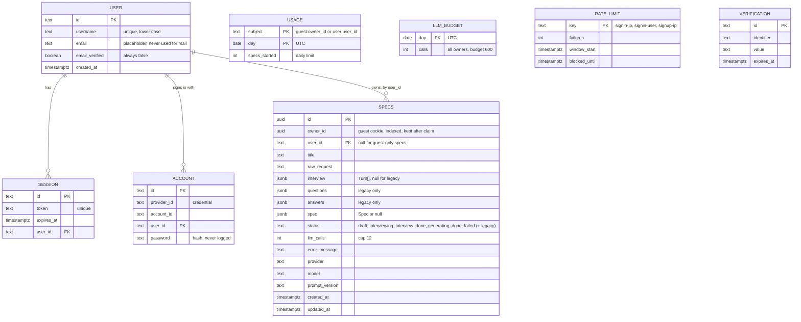

# Architecture

How the pieces fit together: what talks to what, what each LLM step does, how identity and limits work, where data lives, and what happens when a provider fails.

Related: [README](../README.md) · [Design decisions](DESIGN_DECISIONS.md) · [Prompt design](PROMPT_DESIGN.md) · [Evals](EVALS.md)

## System context



Guests have no account. Each browser gets an anonymous `ss_owner` cookie. Signed-in users are identified by a Better Auth session cookie. Every spec query is filtered by the owner (see [Identity, accounts and limits](#identity-accounts-and-limits)).

## The three LLM steps

The app makes three kinds of model call. Each one is validated before anything is saved.

| Step | Trigger | Input | Output | Route |
|---|---|---|---|---|
| Next question | Submit a request, or send an answer | Request, full transcript, known facts, whether `done` is allowed | `InterviewTurnResponse` (one question, or `done`) | `POST /api/specs/:id/interview/next` |
| Repair | Any step whose output fails parsing or validation | The original messages, the bad output, the validation errors | Corrected JSON, same schema | Inside the LLM client. Not a route |
| Spec | Generate | Request and full transcript | `Spec` | `POST /api/specs/:id/generate` (SSE) |

### Question request



Resume is different. A pending question with no answer is returned with no LLM call.

### Generate request (SSE)



Checks that can refuse a request run before the stream opens, because an SSE response cannot change its status after it starts. Errors during the run arrive as `event: error`.

## Error and fallback flow

```mermaid
flowchart TD
    start([Call LLM client]) --> next{Next provider<br/>with a key?}
    next -- no more --> fail[[Throw LLMUnavailableError<br/>per-provider summary, no secrets]]
    next -- yes --> cool{In 60 s cooldown<br/>after a 429?}
    cool -- yes --> skip[Skip provider] --> next
    cool -- no --> call[Send request<br/>timeout 40 s default]
    call -- 429 --> cd[Start 60 s cooldown] --> next
    call -- 5xx, timeout, network, other --> next
    call -- 200 --> parse{Parse JSON<br/>strip code fences}
    parse -- ok --> zod{Zod and integrity checks}
    parse -- fail --> repair
    zod -- ok --> done([Return value])
    zod -- fail --> repair{Repair already tried<br/>on this provider?}
    repair -- no --> rep[One repair call<br/>same provider] --> parse
    repair -- yes --> next
```

Notes:
- Every request counts toward the spec's call cap and the global daily budget, including repairs and fallbacks. Both are reserved before each request is sent.
- A failed repair moves to the next provider. It does not retry the same provider again.
- A 401 or other 4xx also moves to the next provider. Only a 429 starts a cooldown.
- The API maps `LLMUnavailableError` to HTTP 503 with a friendly message and a retry option.

## Module map

| Module | Responsibility |
|---|---|
| `src/lib/llm/` | `LLMProvider` interface, OpenAI-compatible client, registry from env, fallback and cooldown, JSON extraction and repair |
| `src/lib/prompts/` | Versioned prompts (`PROMPT_VERSION = "v2"`), transcript formatting |
| `src/lib/schemas/` | Zod schemas for turns, questions, specs; integrity checks (`superRefine`) |
| `src/lib/interview/` | Interview state machine: next, undo, finish, resume, limits |
| `src/lib/specs/` | Generation service, wizard step rules, input limits, spec and budget limits before each provider request |
| `src/lib/db/` | Drizzle schema (app tables, auth tables, rate limits, budget), owner-scoped repository |
| `src/lib/owner/` | The `Owner` type (guest or user), spec and usage scopes, cookie resolution |
| `src/lib/auth/` | Better Auth config, the `/api/auth` gate, credential rules, rate limits, identity lookup, claiming and account deletion |
| `src/lib/theme/` | Theme choice and the inline script that applies it before first paint |
| `src/lib/export/` | `toMarkdown`, deterministic and snapshot-tested |
| `src/lib/api/` | Typed JSON errors and request helpers |
| `src/lib/server/` | Dependency wiring (DB, LLM client, limits), built once per process |
| `src/lib/evals/` | Metric functions used by the eval runner |
| `src/app/` | Pages (`/`, `/specs/[id]`, `/history`, `/sign-in`, `/sign-up`, `/privacy`) and route handlers (`/api/specs`, `/api/auth`, `/api/me`, `/api/account`) |
| `src/components/` | Page components, the header and account menu, the guest banner and claim prompt, and `ui/` primitives |
| `e2e/` | Playwright tests for the account flows (`npm run test:e2e`) |
| `evals/` | Cases, runner, saved results |

## Identity, accounts and limits

### Who is acting

`ownerFrom` in `src/lib/auth/identity.ts` decides the owner for every spec route and every limit check:

1. If there is a valid Better Auth session, the caller is a **user**. The owner carries the user's id and the guest cookie id.
2. Otherwise, a valid `ss_owner` cookie makes the caller a **guest**.
3. Otherwise there is no owner. Route handlers return 401 `owner_required`. Server pages show no specs.

Scopes are applied in one place, `src/lib/owner/scope.ts`, so no query builds its own filter:

| Owner | Sees | Limit that applies |
|---|---|---|
| Guest | Specs with `owner_id` equal to the cookie and `user_id` null | `DAILY_SPEC_LIMIT` (default 5) |
| User | Specs with `user_id` equal to the user's id, whichever browser made them | `DAILY_SPEC_LIMIT_USER` (default 8) |

Identity never comes from the request body.

### Sign-up and sign-in

Better Auth handles passwords, sessions and cookies. The app puts a gate in front of it, in `src/app/api/auth/[...all]/route.ts`:

- Only four library routes are reachable: `get-session`, `sign-in/username`, `sign-up/email`, and `sign-out`. Every other path returns 404, so the library's reset and verification routes are never exposed.
- Sign-up checks the username and password rules before the library is called. A new account gets the placeholder address `<username>@users.invalid`. The app never sends mail, and verification is off.
- Sign-in answers every failure with the same message, "Invalid username or password". The message never says which part was wrong.



### Claiming guest specs and deleting an account

- **Claim.** After sign-in, the home page asks "Keep my N guest specs in this account?" when the browser's cookie owns specs with no `user_id`. Keeping them sets `user_id` on those specs only, where `owner_id` is this cookie. A second claim moves nothing. Usage takes the larger of the guest's and the user's count for the day, so a claim never resets a limit.
- **Delete.** `DELETE /api/account` with `{ "confirm": "delete" }` signs the browser out, then removes the user's specs, usage rows, sessions and account in one transaction. Guest specs in the same browser are not affected.

### Rate limits and the global budget

Counters live in Postgres (`rate_limit`, `llm_budget`), so they hold across serverless instances. They are best effort, not a security boundary.

| Limit | Value | Where it is checked | Refusal |
|---|---|---|---|
| Sign-in per IP | 20 attempts in 15 minutes | Auth gate, before Better Auth | 429 `rate_limited` |
| Sign-in per username | Lock from the 5th consecutive failure: 1 minute, doubling to a 60-minute cap. A success resets it | Auth gate | 429 `rate_limited` |
| Sign-up per IP | 5 attempts in one hour | Auth gate | 429 `rate_limited` |
| New specs per UTC day | Guest 5, signed in 8 | Spec service, before any provider call | 429 `daily_limit` |
| AI calls per spec | 12, every provider request counts | Before each provider request | 429 `spec_call_limit` |
| Provider requests per UTC day | 600 across all owners | Before each provider request, after the spec cap | 429 `demo_capacity` |

The provider-request hook in `src/lib/specs/limits.ts` runs before every request the LLM client makes, including fallbacks and repairs. Both the spec cap and the global budget are reserved there with a conditional update, so a refused request never reaches a provider.

Credential rules (`src/lib/auth/rules.ts`): usernames are 3 to 24 letters, digits or underscores, stored in lower case. Passwords are 10 to 128 characters with no composition rules. A short list of very common passwords is refused.

## Data model

Tables are created by the migrations in [`drizzle/`](../drizzle). `specs` and `usage` are the app's own tables. The rest belong to Better Auth, the rate limiter and the global budget.



`usage` is keyed by subject and UTC day. The subject is `guest:<owner_id>` for a guest or `user:<user_id>` for a signed-in user. Each new spec increments it once, at its first question. A failed first question still counts. Migration `0003` rewrote the old rows to `guest:<owner_id>`.

## Deployment

- **Hosting:** Vercel, Next.js build. Environment variables follow [`.env.example`](../.env.example). Accounts need `BETTER_AUTH_SECRET` and `BETTER_AUTH_URL`. `DAILY_SPEC_LIMIT_USER` (default 8) and `GLOBAL_DAILY_LLM_CALL_BUDGET` (default 600) have defaults.
- **Database:** Neon Postgres, migrations applied with `npm run db:migrate`. Migration `0003` rewrites existing usage rows, so run every migration before the new code serves requests.
- **Connection:** one `postgres-js` connection per process with `max: 1`, which suits serverless warm starts.
- **CI:** GitHub Actions runs lint, typecheck and tests on every push and pull request ([`ci.yml`](../.github/workflows/ci.yml)). The end-to-end tests run locally with `npm run test:e2e`.
- **End-to-end tests:** Playwright runs against a production build on port 3100. They use the database in `.env.local`, so each run creates and then deletes one test account. Sign-up is limited to 5 per IP per hour.
- **Timeouts:** the Hobby tier limits a function to 60 seconds. A long question-plus-repair-plus-fallback sequence can approach that. See the limitations in the [README](../README.md#limitations-and-next-steps).
