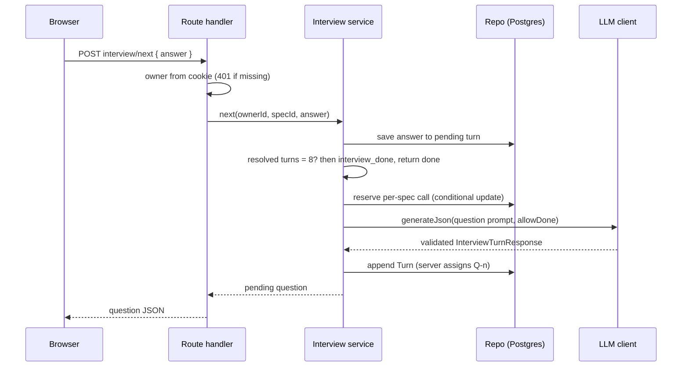
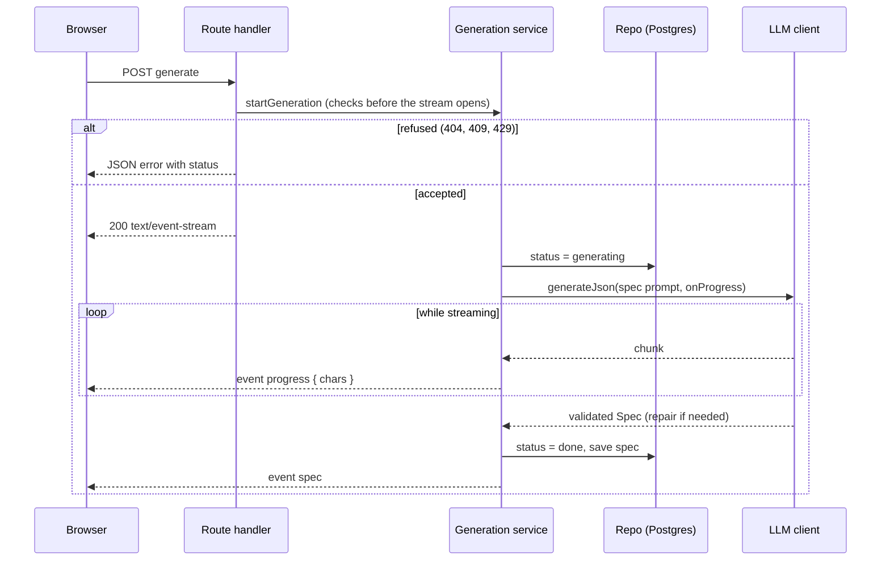
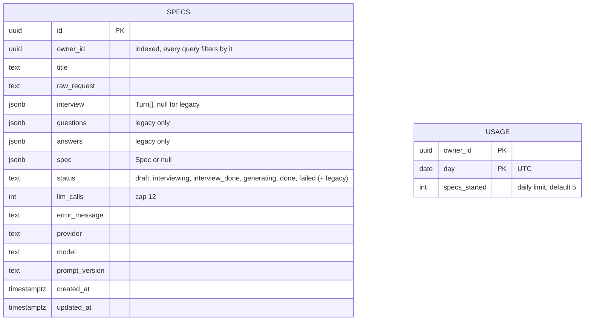

# Architecture

How the pieces fit together: what talks to what, what each LLM step does, where data lives, and what happens when a provider fails.

Related: [README](../README.md) · [Design decisions](DESIGN_DECISIONS.md) · [Prompt design](PROMPT_DESIGN.md) · [Evals](EVALS.md)

## System context


There are no accounts. Each browser gets an anonymous `ss_owner` cookie, and every query is filtered by it.

## The three LLM steps

The app makes three kinds of model call. Each one is validated before anything is saved.

| Step | Trigger | Input | Output | Route |
|---|---|---|---|---|
| Next question | Submit a request, or send an answer | Request, full transcript, known facts, whether `done` is allowed | `InterviewTurnResponse` (one question, or `done`) | `POST /api/specs/:id/interview/next` |
| Repair | Any step whose output fails parsing or validation | The original messages, the bad output, the validation errors | Corrected JSON, same schema | Inside the LLM client. Not a route |
| Spec | Generate | Request and full transcript | `Spec` | `POST /api/specs/:id/generate` (SSE) |

### Question request



Resume is different. A pending question with no answer is returned with no LLM call.

### Generate request (SSE)



Checks that can refuse a request run before the stream opens, because an SSE response cannot change its status after it starts. Errors during the run arrive as `event: error`.

## Error and fallback flow

```mermaid
flowchart TD
    start([Call LLM client]) --> next{Next provider<br/>with a key?}
    next -- no more --> fail[[Throw LLMUnavailableError<br/>per-provider summary, no secrets]]
    next -- yes --> cool{In 60 s cooldown<br/>after a 429?}
    cool -- yes --> skip[Skip provider] --> next
    cool -- no --> call[Send request<br/>timeout 40 s default]
    call -- 429 --> cd[Start 60 s cooldown] --> next
    call -- 5xx, timeout, network, other --> next
    call -- 200 --> parse{Parse JSON<br/>strip code fences}
    parse -- ok --> zod{Zod and integrity checks}
    parse -- fail --> repair
    zod -- ok --> done([Return value])
    zod -- fail --> repair{Repair already tried<br/>on this provider?}
    repair -- no --> rep[One repair call<br/>same provider] --> parse
    repair -- yes --> next
```

Notes:
- Every request counts toward the spec's call cap, including repairs and fallbacks. The count is reserved before each request is sent.
- A failed repair moves to the next provider. It does not retry the same provider again.
- A 401 or other 4xx also moves to the next provider. Only a 429 starts a cooldown.
- The API maps `LLMUnavailableError` to HTTP 503 with a friendly message and a retry option.

## Module map

| Module | Responsibility |
|---|---|
| `src/lib/llm/` | `LLMProvider` interface, OpenAI-compatible client, registry from env, fallback and cooldown, JSON extraction and repair |
| `src/lib/prompts/` | Versioned prompts (`PROMPT_VERSION = "v2"`), transcript formatting |
| `src/lib/schemas/` | Zod schemas for turns, questions, specs; integrity checks (`superRefine`) |
| `src/lib/interview/` | Interview state machine: next, undo, finish, resume, limits |
| `src/lib/specs/` | Generation service, wizard step rules, input limits, view helpers |
| `src/lib/db/` | Drizzle schema, owner-scoped repository, daily and per-spec reservation |
| `src/lib/export/` | `toMarkdown`, deterministic and snapshot-tested |
| `src/lib/owner/` | Owner cookie resolution |
| `src/lib/api/` | Typed JSON errors and request helpers |
| `src/lib/server/` | Dependency wiring (DB, LLM client, limits), built once per process |
| `src/lib/evals/` | Metric functions used by the eval runner |
| `src/app/` | Pages (`/`, `/specs/[id]`, `/history`) and route handlers |
| `src/components/` | Page components and `ui/` primitives |
| `evals/` | Cases, runner, saved results |

## Data model



`usage` is keyed by owner and UTC day. Each new spec increments it once, at its first question. A failed first question still counts.

## Deployment

- **Hosting:** Vercel, Next.js build. Environment variables follow [`.env.example`](../.env.example).
- **Database:** Neon Postgres, migrations applied with `npm run db:migrate`.
- **Connection:** one `postgres-js` connection per process with `max: 1`, which suits serverless warm starts.
- **CI:** GitHub Actions runs lint, typecheck and tests on every push and pull request ([`ci.yml`](../.github/workflows/ci.yml)).
- **Timeouts:** the Hobby tier limits a function to 60 seconds. A long question-plus-repair-plus-fallback sequence can approach that. See the limitations in the [README](../README.md#limitations-and-next-steps).
